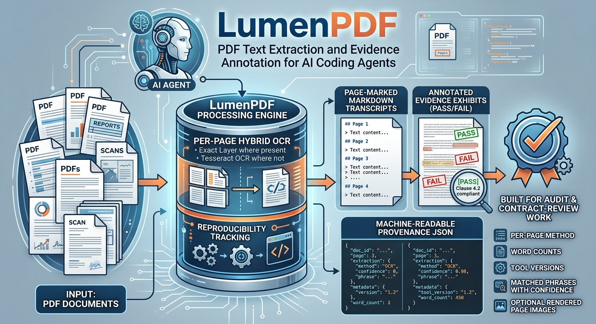

# LumenPDF



PDF text extraction and evidence annotation for AI coding agents. Per-page hybrid OCR (exact text layer where present, tesseract OCR where not), page-marked Markdown transcripts, annotated evidence exhibits, and machine-readable provenance for every artifact.

Built for document review: every extraction and annotation is reproducible, whatever the PDF - contracts, invoices, statements, policies, forms, or scanned correspondence. Per-page method, word counts, tool versions, matched phrases with OCR confidence, and optional rendered page images.

**[See it working →](https://audit-brands.github.io/lumenpdf/)** A real PDF, a real exhibit, and the provenance record behind it, all produced by the scripts in this repository and displayed with [Slipsheet](https://github.com/jonto/slipsheet).
## Contents

```
assets/                       # media assets (banner image)
SKILL.md                      # agent-facing skill instructions (portable format)
scripts/ocr_pdf.py            # extraction: per-page hybrid, --provenance, --keep-images
scripts/annotate_pdf.py       # annotation: pymupdf text mode + tesseract OCR mode
references/annotation-reference.md   # the annotation methodology (document review
                                     # workpaper exhibits)
install.sh                    # deploy to agent skill directories
index.html                    # live demo page (GitHub Pages)
demo/build.py                 # regenerates every demo artifact from the real scripts
```

## Quick install

### For everyone: let your agent do it

1. Download the repository: use the green **Code** button on GitHub and pick **Download ZIP**, then unzip it.
2. Open Claude Code (or pi) in the unzipped folder and say:

> "Install the LumenPDF skill from this folder into your skills directory, and install all of its dependencies."

The agent copies the skill folder into its skills directory, runs `pip install pymupdf pillow`, installs tesseract if your OS needs it, and reports what it set up. After that, LumenPDF is available in every session - just ask.

## Quick start

### For everyone: just ask your agent

If LumenPDF is installed as a skill (see "Quick install" above), you do not run anything by hand. Open Claude Code (or pi), make sure the PDF is in your working folder, and ask:

> "OCR invoice_2026-03.pdf and keep the provenance."

> "Screen this agreement and annotate an exhibit showing the termination
> clause, then make one showing the missing audit-rights clause."

The agent reads this skill, installs anything missing (`pip install pymupdf pillow`, and tesseract if the PDF is scanned), runs the scripts, and reports back with the transcript, exhibits, and provenance files. If it asks whether to keep page images and the provenance JSON, that is the documented agent behavior - answering "yes, both" is right for audit work.

## Examples

Live, no checkout required:

- **[audit-brands.github.io/lumenpdf](https://audit-brands.github.io/lumenpdf/)** - an exhibit boxing the Abstract of Mozilla's tracemonkey paper (the same PDF the Slipsheet demo uses), a switch to the untouched source, and the provenance record read live from the files LumenPDF wrote
- **[demo/](demo/)** - every file behind the demo, as written: [`spec.json`](demo/spec.json), the [annotation provenance](demo/exhibits/tracemonkey_annotations.prov.json), the [transcript](demo/tracemonkey.md), and the [extraction provenance](demo/tracemonkey.prov.json)

Or rebuild and run it locally:

```bash
python3 demo/build.py           # regenerates everything in demo/ from the real scripts
python3 -m http.server 8000     # static server on :8000
# then open http://localhost:8000
```

## Technical install

For the technically inclined, or for scripted/CI environments.

Clone or download the repository, then deploy the skill and install dependencies:

```bash
git clone git@github.com:audit-brands/lumenpdf.git && cd lumenpdf
./install.sh          # all detected runtimes (pi: ~/.agents/skills, Claude Code: ~/.claude/skills)
./install.sh claude   # Claude Code only
./install.sh pi       # pi only
./install.sh --uninstall

pip install pymupdf pillow
```

### Runtime dependencies

LumenPDF has three third-party dependencies. Two are pip packages with prebuilt wheels on every supported OS; the third (tesseract) is a binary installed per OS. Nothing else is required: no poppler, no compiler, no WSL.

| Component | Role | License | Install |
|---|---|---|---|
| PyMuPDF (`pymupdf`) | PDF parsing, text extraction, page rendering | AGPL-3.0 or Artifex commercial | `pip install pymupdf` |
| Pillow (`pillow`) | Image drawing for OCR-mode annotation exhibits | MIT-CMU | `pip install pillow` |
| Tesseract OCR | OCR of image-based pages; TSV word coordinates for annotation | Apache-2.0 | per-OS commands below |

Tesseract is only needed when a PDF has scanned/image-based pages (or for OCR-mode annotation). Install it per OS:

| OS | Command |
|---|---|
| macOS | `brew install tesseract` |
| Debian/Ubuntu | `sudo apt install tesseract-ocr` |
| Fedora/RHEL | `sudo dnf install tesseract` |
| Windows native | `winget install UB-Mannheim.TesseractOCR` (or the UB-Mannheim installer), then add to PATH |
| WSL | use the Linux command inside WSL |

To verify your installation:

```bash
python3 -c "import pymupdf, PIL; print('pymupdf', pymupdf.__version__)"
tesseract --version
```

Note on PyMuPDF licensing: it is dual-licensed AGPL-3.0 / commercial. LumenPDF uses it as an unmodified installed dependency; see `NOTICE.md` for what that means if your organization licenses installed dependencies strictly.


## Technical use

The same workflows as the quick start, driven directly from the command line:

```bash
# extract text (hybrid, with full provenance)
python3 scripts/ocr_pdf.py invoice.pdf invoice_text.md --provenance --keep-images

# annotate the deciding passages
cat > spec.json <<'EOF'
[{"page": 2, "kind": "pass",
  "label": "PASS EVIDENCE: duplicate charge documented",
  "phrases": ["amount due", "payment received"]}]
EOF
python3 scripts/annotate_pdf.py invoice.pdf --spec spec.json --outdir exhibits --provenance
```

All parameters for both scripts are documented in the "Reference: all parameters" section below.


## Reference: all parameters

Every parameter of both scripts is documented here. Anything not listed in this section does not exist: no hidden flags, no environment-variable overrides, no config files.

### `scripts/ocr_pdf.py` - text extraction

```
python3 scripts/ocr_pdf.py <input.pdf> [output.md] [options]
```

| Parameter | Type / default | Description |
|---|---|---|
| `input` (positional) | path, required | Input PDF. Must exist and be readable (decrypt encrypted PDFs first). |
| `output` (positional) | path, optional | Output Markdown transcript. Default: `<input-stem>_text.md` next to the input. |
| `--dpi N` | int, `200` | Render DPI for pages sent to tesseract. Raise to 300 for faint scans or small fonts. Ignored when no page needs OCR and `--keep-images` is off. |
| `--range N-M` | string, all pages | 1-indexed inclusive page range. `5` means page 5 only. Closed ranges only; open-ended forms are not accepted. Invalid ranges exit with an error. |
| `--force-ocr` | flag, off | OCR every page in range, including pages with a healthy text layer. |
| `--no-ocr` | flag, off | Never invoke tesseract. Pages below the word threshold are passed through with their (sparse) text and listed as `thin pages` in the report. |
| `--min-words N` | int, `20` | Per-page text-layer word count below which a page is OCR'd instead. Raise (e.g. 50) for PDFs whose text layer is fragmentary. |
| `--lang CODES` | string, `eng` | Tesseract language(s), `+`-joined (e.g. `eng+deu`). Extra languages require the corresponding tesseract language pack. Also recorded in provenance. |
| `--psm N` | int, `6` | Tesseract page segmentation mode passed to OCR calls. `6` = assume a uniform block of text (good for letters and agreements); `3` is the fully automatic default. OCR falls back to psm 3 automatically if the requested mode fails. |
| `--keep-images` | flag, off | Save each rendered page PNG to `<input-dir>/<stem>_pages/page-NN.png`. Applies to OCR'd pages always, and to text-layer pages too (as pixel-level provenance). |
| `--provenance` | flag, off | Write a sidecar JSON next to the output: `<output>.prov.json`. |

Exit codes: `0` success; non-zero on missing dependencies, missing input, or an invalid page range. Progress is printed per page to stderr; the summary report goes to stdout.

Provenance JSON contents (`<output>.prov.json`): `transcript`, `source`, `extracted_utc`, `pages_total`, `page_range`, `pages_text_layer`, `pages_ocr`, `min_words_threshold`, `force_ocr`, `no_ocr`, `images_kept`, `output_words`, `output_bytes`, `tools` (pymupdf and tesseract versions), and per-page records (`page`, `method`, `pdftotext_words`, `chars`, plus `image`/`dpi`/`ocr_lang` where applicable).

### `scripts/annotate_pdf.py` - evidence exhibits

```
python3 scripts/annotate_pdf.py <input.pdf> --spec spec.json --outdir DIR [options]
```

| Parameter | Type / default | Description |
|---|---|---|
| `input` (positional) | path, required | Input PDF to annotate. |
| `--spec FILE` | path, required | Annotation spec JSON (fields below). |
| `--outdir DIR` | path, required | Directory for exhibit PNGs (created if missing). Intermediate raw renders are removed after each exhibit is saved. |
| `--dpi N` | int, `120` | Render DPI for exhibit images. 120 is readable for workpapers; raise for print quality. |
| `--lang CODES` | string, `eng` | Tesseract language for OCR-mode pages. |
| `--min-confidence N` | float, `60.0` | Minimum average tesseract word confidence (0-100) for an OCR match to be drawn. Matches below it are listed under `flagged_low_confidence` in the provenance instead. Text-layer matches are never confidence-gated. |
| `--provenance` | flag, off | Write `<stem>_annotations.prov.json` into `--outdir`. |

Annotation spec JSON fields (one object per exhibit):

| Field | Required | Description |
|---|---|---|
| `page` | yes | 1-indexed page number to annotate. |
| `label` | yes | Banner text. Convention: `PASS EVIDENCE: ...`, `FAIL EVIDENCE: ...`, `NOTE: ...`, `CONTRAST: ...`, `EXECUTION: ...`. |
| `kind` | no, default `note` | `pass` (blue banner, red boxes), `fail` (red banner, red boxes), `note` (blue banner, green boxes), `contrast` (blue banner, orange boxes), `execution` (blue banner, blue boxes). |
| `phrases` | no | List of phrases to search for and box. 3-8 distinctive words each works best. All occurrences are matched; hits are clustered into one box per passage. |
| `banner` | no, default `top` | `top` or `bottom`. Use `bottom` when the top of the page has no whitespace. |
| `filename` | no, default `<stem>_EX_p<page>_<kind>.png` | Output exhibit filename inside `--outdir`. |

Mode selection per page: pages with >= 20 words of extractable text are annotated with pymupdf (`search_for` + merged passage rects); sparser pages are rendered and annotated from tesseract TSV word coordinates. The provenance records `mode`, per-phrase `line_rects`/`confidence`, per-exhibit `boxes`, `missed` phrases, and `flagged_low_confidence` entries. Exhibits with zero matches print a WARNING to stderr and are still saved (banner only) so the gap is visible.

## Acknowledgments

LumenPDF stands on third-party tools: [PyMuPDF](https://pymupdf.readthedocs.io/) for PDF parsing and rendering, [Pillow](https://python-pillow.org/) for image drawing, and [Tesseract OCR](https://github.com/tesseract-ocr/tesseract) for optical character recognition. See `NOTICE.md` for component roles and licensing (PyMuPDF is AGPL-3.0 or commercial - check the note there if your organization licenses installed dependencies strictly).

The annotation methodology comes from document review workpaper practice, contributed by Audit Risk Media, LLC (CC BY 4.0).

## License

MIT for the scripts and skill (see `LICENSE`); CC BY 4.0 for the annotation methodology in `references/annotation-reference.md` (see `references/annotation-reference.LICENSE`). Attribution requirements are summarized in `NOTICE.md` - retain LICENSE and NOTICE when redistributing.

## Design notes

- **Cross-platform by construction**: pymupdf/pillow are pure-pip wheels on macOS, Linux, and Windows; the only external binary is tesseract. No poppler, no coreutils, no WSL required on Windows.
- **Provenance ladder**: page markers -> per-page method comments -> optional page images -> provenance JSON. `--provenance` alone is enough for machine-checkable lineage; add `--keep-images` when pixel-level verification matters.
- **Model-agnostic**: no LLM or decision-model dependency. Classification and screening workflows consume the transcript; this skill only handles documents.

## Made with ♥

Made with love from Atlanta, GA.
